# Assembly Tips

This section documents my personal approach to assembling the M2PS2 PCB, including component placement, hot plate reflow and some of the challenges along the way.

My usual process is to pre-tin the required footprints, place the components, reflow the board on a hot plate, and then carry out any necessary touch-ups after reflow.

***This is not intended as a step-by-step assembly tutorial.*** I have a fair amount of prior PCBA experience, and the methods described here are simply what I have found works well for me when assembling small PCBs in general. There are, of course, other perfectly valid approaches.

That said, this project does require a reasonable level of soldering experience. Some of the components, especially the fine-pitch flex connector, are extremely delicate and can be challenging to assemble even with suitable equipment and experience. If you're relatively new to soldering, it's worth bearing this in mind before taking on the project, as some aspects of the assembly may prove difficult without prior experience.

## Alternative Assembly Methods

Pre-tinning the footprints and using a hot plate is simply my preferred approach. Other options include:

- Applying solder paste by hand before placing the components and reflowing.
- Hand soldering all components using a soldering iron.
- Using hot air for most components, with the exception of the FFC and M.2 connectors.

Personally, I wouldn't recommend using hot air for the entire board. Given its relatively small size, repeated exposure to high temperatures can introduce considerable thermal stress and potentially cause the PCB to warp.

## Contents

- [PCB Assembly](#pcb-assembly)
  - [Optional Resistors (R3–R6)](#optional-resistors-r3r6)
  - [Optional Power Switch Bypass](#optional-power-switch-bypass)
- [Flex Connector](#flex-connector)
- [Component Inspection](#component-inspection)
- [Final Cleaning](#final-cleaning)

## PCB Assembly

My preferred method is to pre-tin the component footprints by hand using a soldering iron, leaving R3, R4, R5 and R6 unpopulated.

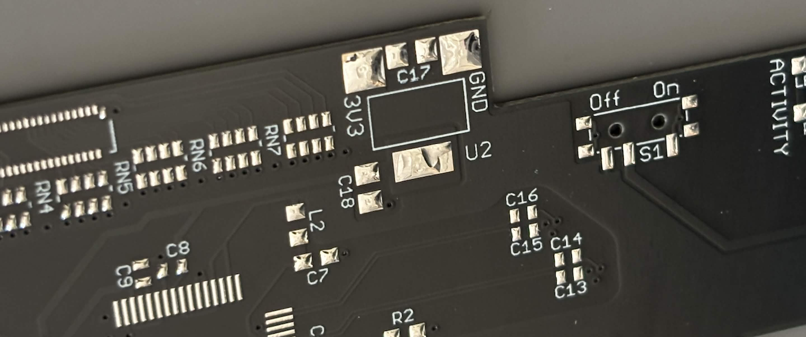

Once all the necessary footprints have been tinned, I thoroughly clean the board to remove any spent flux residue. I then apply a small amount of fresh flux to the footprints before placing the components.

Be careful not to apply too much flux. Excessive flux can cause components to float or tombstone during hot plate reflow.

I also recommend applying less solder than usual to the LED, inductor and crystal oscillator footprints. These components have relatively small pads and can struggle to sit flat during reflow if too much solder is applied.

Before reflowing on the hot plate, I carry out a visual inspection of the component placement to ensure everything is correctly aligned.

Once the components are positioned, I reflow the board using the hot plate. The required temperature will depend on the solder alloy being used.

During reflow, pay close attention to the legs of the flex connector, M.2 connector and Marvell IC. You want to see the solder flow beneath the component legs and properly wet the underside of each leg. Once the solder is fully molten, you can gently press down on the top of these components to help ensure they are sitting flat and making good contact with their pads.

Keep an eye on the remaining components too, ensuring they aren't floating away from their pads or tombstoning. If this happens, you can carefully reposition them with tweezers while the solder is still molten, making sure they are properly seated before allowing the board to cool.

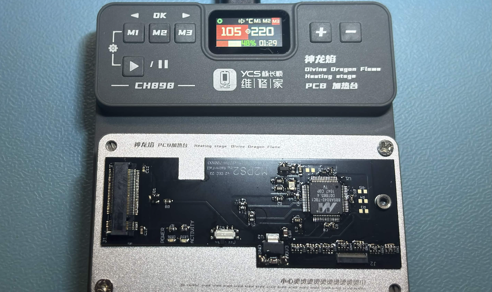

### Optional Resistors (R3–R6)

R3, R4, R5 and R6 are optional components and should normally be left unpopulated.

According to the original BOM, these resistors provide additional pull-up and pull-down functions for certain IDE signals. They are only required if the corresponding resistors are no longer present on the PS2 motherboard.

For a standard installation where these motherboard components are still present, there is no need to populate them.

| Reference | Value | Function | IDE Pin |
|:---|:---|:---|:---|
| R3 | 10kΩ | Pulldown for INTRQ | 31 |
| R4 | 4.7kΩ | Pullup for IORDY | 27 |
| R5 | 5.6kΩ | Pulldown for DMARQ | 21 |
| R6 | 10kΩ | Pulldown for DD7 | 3 |

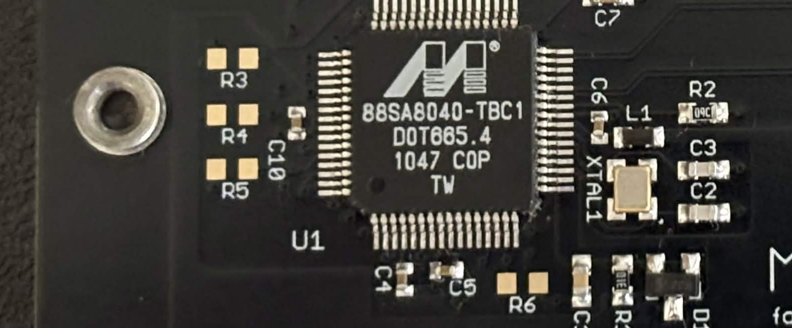

### Optional Power Switch Bypass

If you don't intend to use the on/off power switch and are happy for the M2PS2 to continuously supply power to the SSD whenever the console is powered, you can bypass the switch by bridging the two pads on the power switch footprint with a 0Ω resistor, as shown in the image below.
This removes the need for the physical switch while keeping the power circuit permanently enabled.

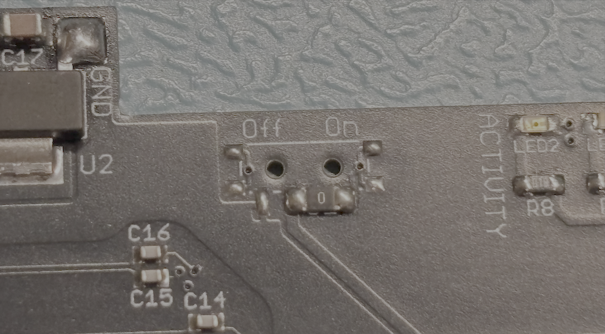

Personally, I wouldn't recommend bypassing the switch. When using optical discs, it's preferable to switch off the M2PS2 when it's not needed, reducing the heat generated by the SSD directly beneath the disc. Keeping the SSD powered continuously adds unnecessary heat in an area where we ideally want to keep temperatures down.

## Flex Connector

The flex connector is arguably the most difficult component to solder reliably.

Several people I've spoken to who have assembled the M2PS2 have also commented on how fragile and difficult this connector can be, regardless of the assembly method used.

In my experience, when using a hot plate, getting the solder coverage as consistent as possible across all the connector pads is most important.

I recommend:

1. Pre-tinning the PCB pads as thoroughly and consistently as possible, ensuring there is enough solder for all the connector pins to make a reliable connection.
2. Lightly pre-tinning the underside of the connector pins themselves. I find this helps improve the chances of a good connection during reflow.
3. Once the solder is fully molten, very gently press down on the top of the connector with tweezers, applying pressure on both sides to help ensure the pins are seated correctly.

Once the board has cooled, I inspect each individual pin under magnification.

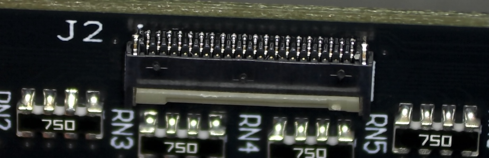

Using a pair of sharp tweezers, I very gently test each pin to check that it has bonded to its corresponding pad. A pin that hasn't properly connected will generally be noticeably loose and easy to move.

**Be extremely gentle when doing this.** The connector pins are fragile, and excessive pressure can easily damage them.

If I find any loose pins, I apply a little additional flux and carefully reflow the affected connections using a fine-tipped soldering iron with a small amount of solder on the tip.

Again, a very gentle touch is essential here. It's easy to damage the pins if too much pressure or heat is applied.

The fine pitch of the pins also makes it easy to accidentally create solder bridges.

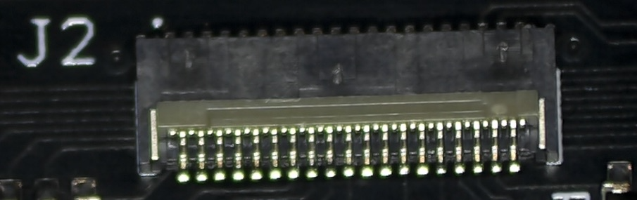

## Component Inspection

Once assembly is complete, I recommend inspecting the solder joints under magnification.

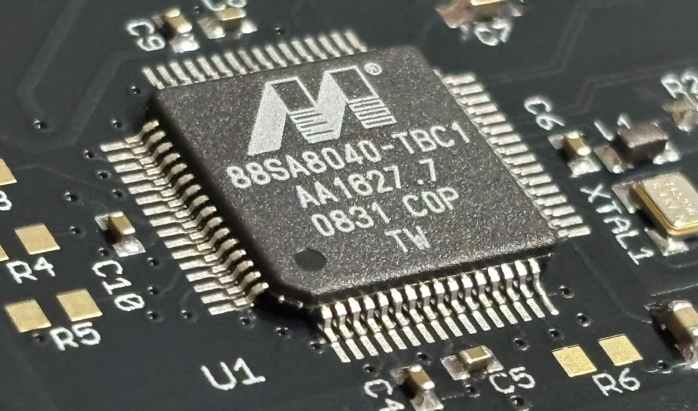

When inspecting fine-pitch components such as the M.2 connector and Marvell IC, look for signs of proper solder wetting. With a successful reflow, solder should have flowed beneath the component legs, forming a visible fillet at the point where each leg meets its pad. You should generally see less solder remaining exposed around the outer edges of the pads, rather than a bead of solder sitting between or alongside the legs.

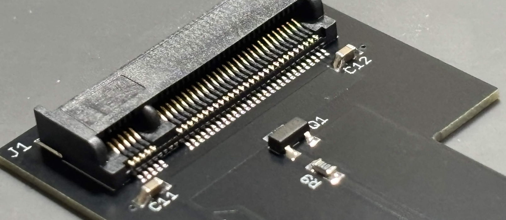

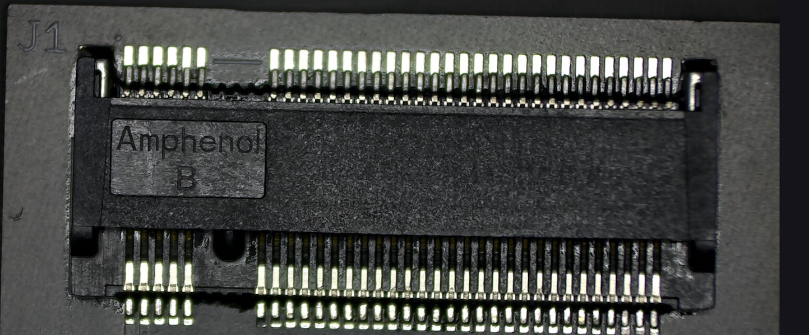

Again, pay close attention to the FFC connector pins and make sure there are no bridges or loose connections.

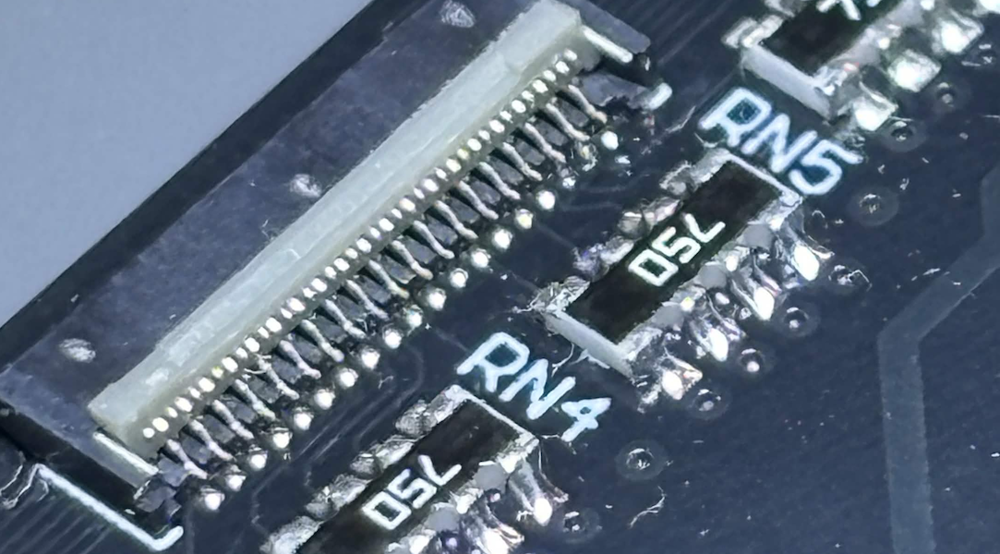

## Final Cleaning

After reflow and any necessary touch-ups, I thoroughly clean the board using IPA and PCB cleaning solution.

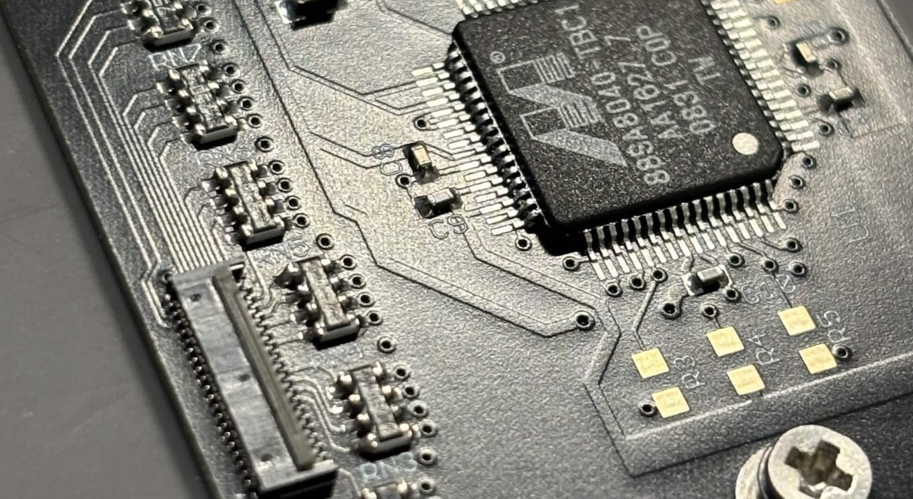

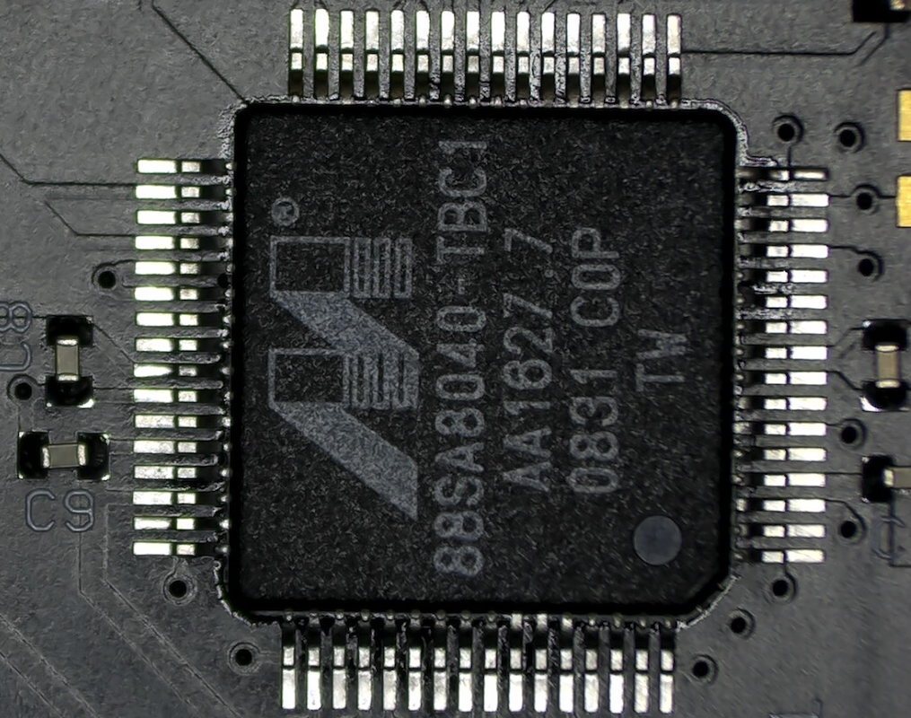

A good clean is especially important around the power switch, M.2 and flex connectors. Residual flux can interfere with reliable electrical contact, and the power switch itself has internal contacts that may also be affected by left over flux.

If using a PCB cleaning solution, particularly one intended for ultrasonic cleaning, make sure the board is completely dry before applying power or carrying out any testing.

I like to place the cleaned boards on a hot plate set to around 50°C and leave them there for an extended period to ensure any remaining moisture has evaporated. Make sure the board is thoroughly dry, especially around connectors before testing.

