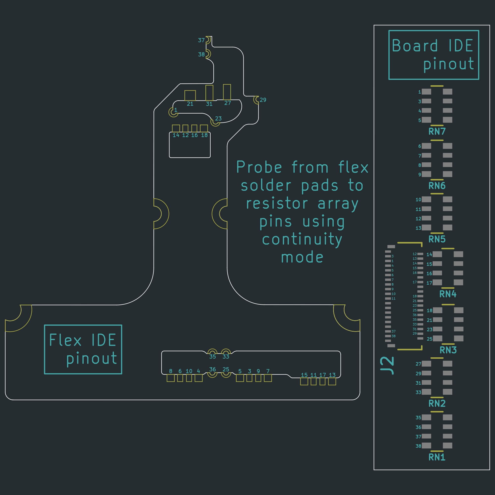

# Diagrams and Testing

This section contains supplementary diagrams to assist with testing and troubleshooting the M2PS2, providing additional references for identifying connections and PCB test points.

All diagrams are intended to complement the original Saint-Fall documentation.

## Flex Cable and M2PS2 Connector

This diagram shows the relevant flex cable connections, Molex connector pins and associated resistor arrays. It serves as a reference for continuity checks and probing during troubleshooting.

### Note:

Continuity testing should always be done with the board disconnected from power.

### More coming soon
