# Install Tips

This section covers a few additional tips and observations from my own M2PS2 installs that may be useful.

## Contents

- [Flex Install Tips](#flex-install-tips)
- [Board Install Tips](#board-install-tips)
- [Power and Ground](#power-and-ground)
- [Shell Cutting](#shell-cutting)

# Flex Install Tips

The flex fits neatly around the CXD9731GP IC on the motherboard, with its pads lining up with the corresponding resistor arrays.

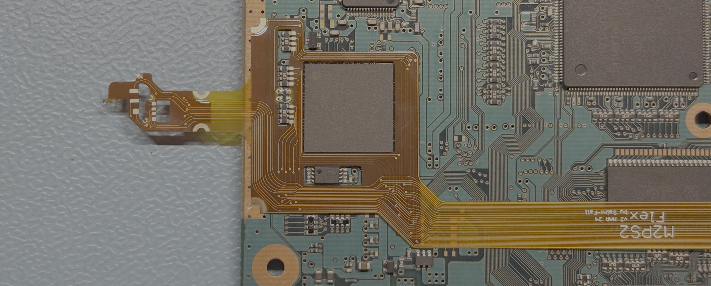

A 100kΩ resistor sits underneath the flex in this area, causing it to lift slightly and preventing the pads from lining up properly with one of the resistor arrays.

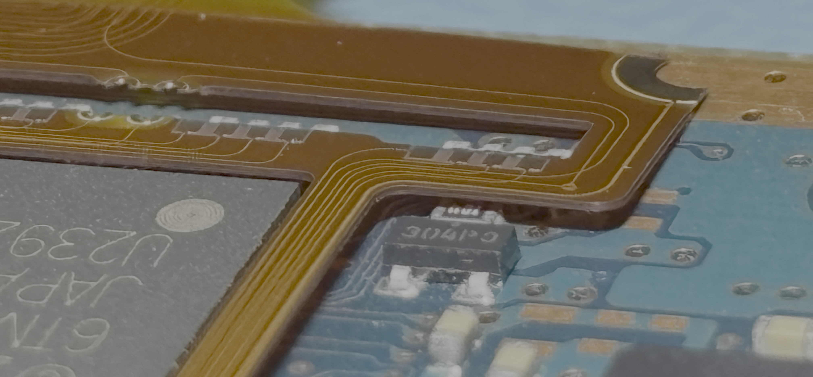

When positioning the flex, gently press it down over the 100kΩ resistor to pivot the pads towards the motherboard and bring them into alignment with the resistor array. The remaining resistor arrays should already line up correctly.

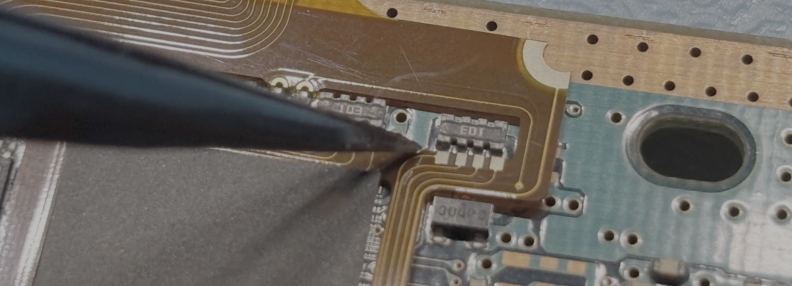

Once the flex has been folded over to the underside of the motherboard, check that it is aligned as shown below.

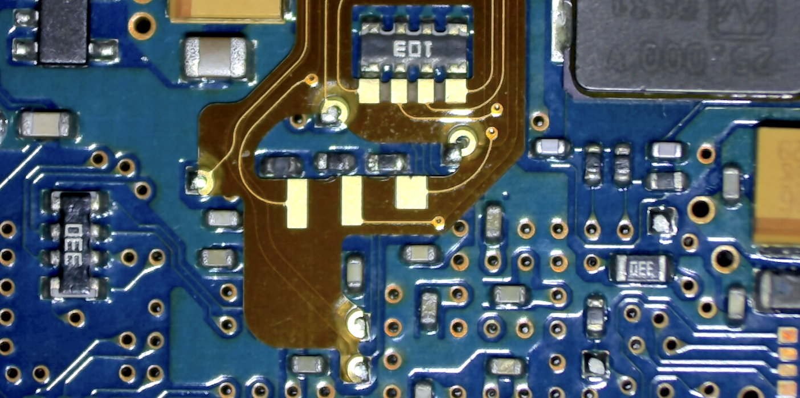

The three 0402 connections can be a little tricky due to the gap between the resistors and the flex. If the solder doesn't bridge the gap easily, a short piece of thin wire can be used to make the connection.

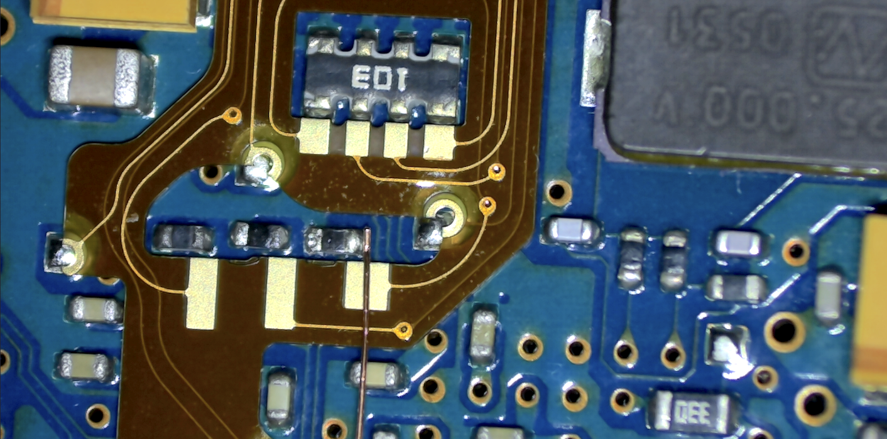

# Board Install Tips

When positioning the M2PS2 board, leave a small gap between its left edge and the right edge of the heatsink if you plan to install a Retro GEM at a later date. The gap only needs to be slightly less than 1mm.

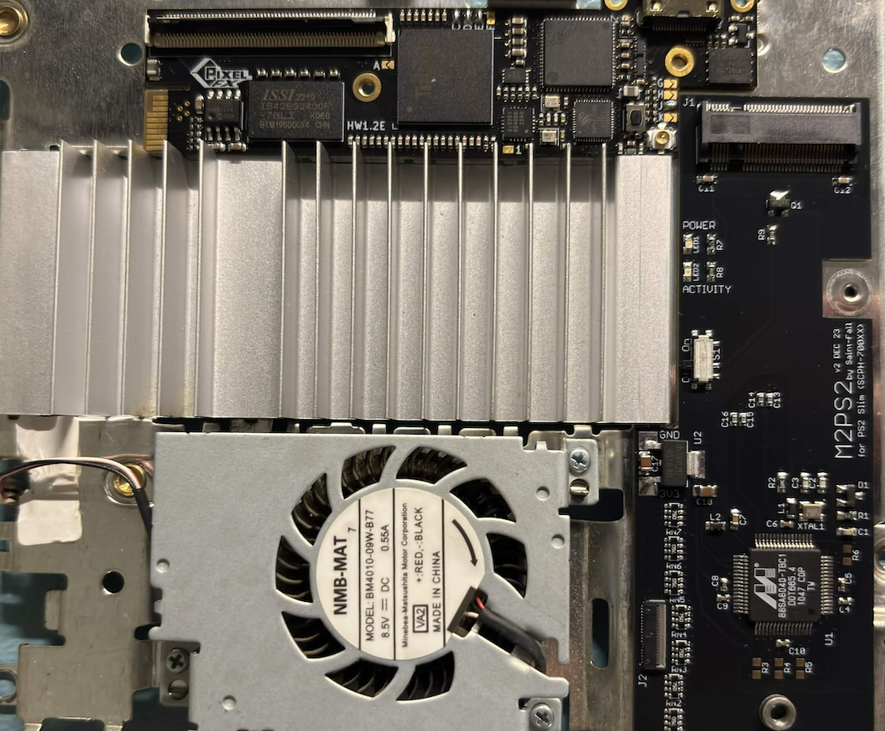

This close-up shows the gap between the right-hand edge of the heatsink and the left-hand edge of the M2PS2 board.

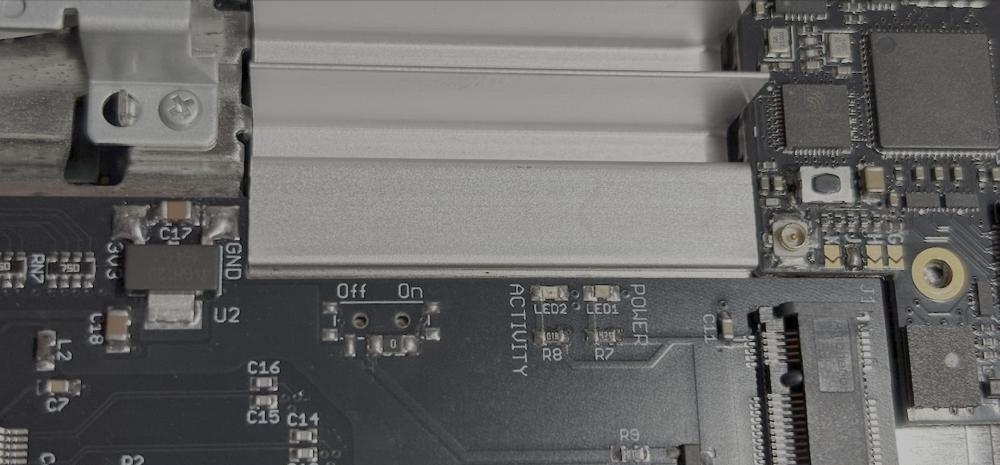

This next photo shows the same positioning but in the top left corner of the M2PS2 board, giving a better view of how the two boards sit together.

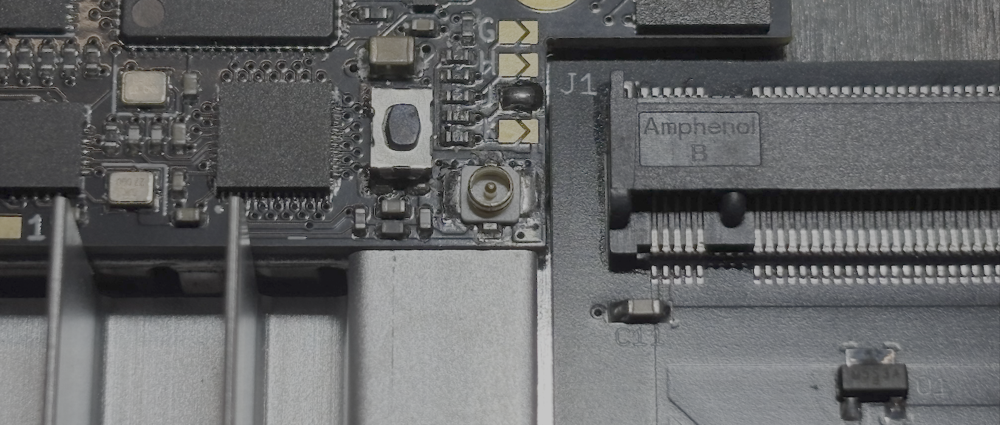

The following photo shows how the Molex connector lines up with the opening in the top shield, and where the flex passes through.

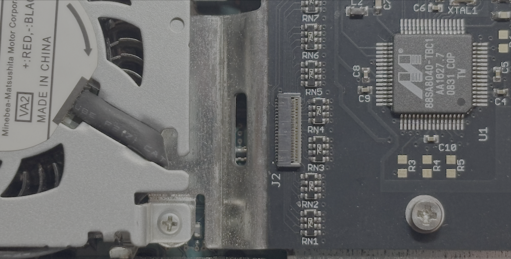

# Power and Ground

## 3.3V

Saint-Fall recommends taking 3.3V from the unpopulated capacitor footprints connected to PS14 (through TH3000). These footprints are located on the top side of the motherboard, near the clock battery connector.

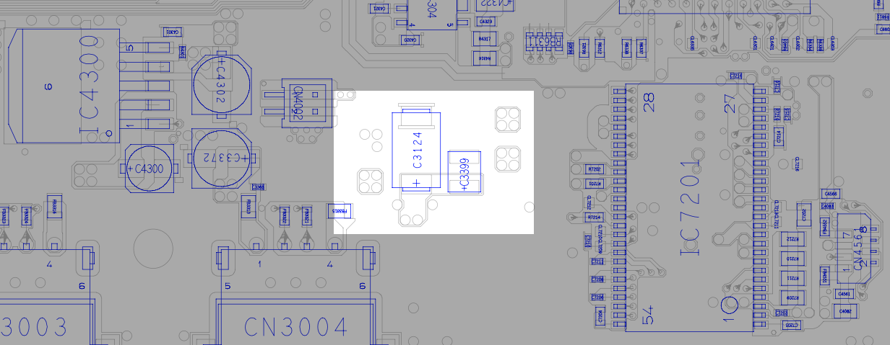

The unpopulated capacitor footprints and surrounding copper can look a little different between motherboard revisions. The following examples show the 3.3V pads and their connected copper planes, highlighted in red. The ground pads are highlighted in blue.

### GH-032-11
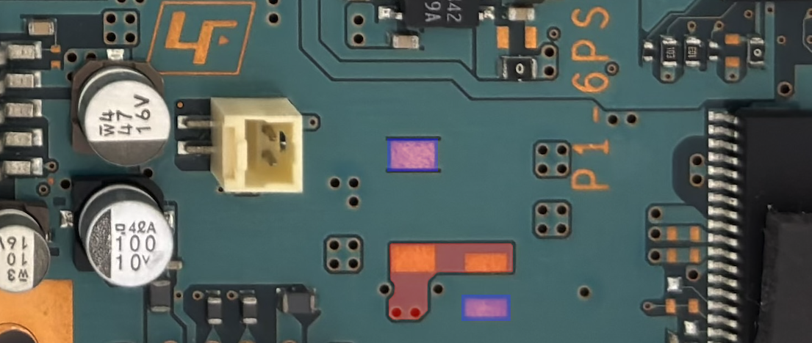

### GH-032-31
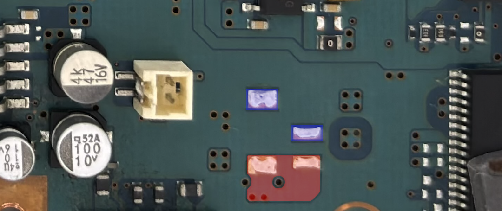

### GH-032-32
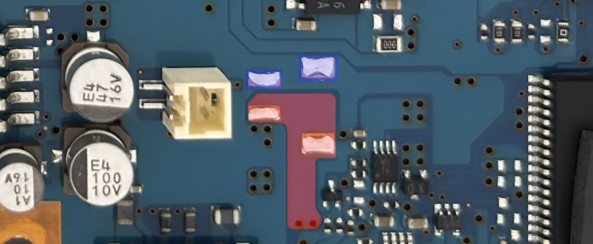

### GH-035-11
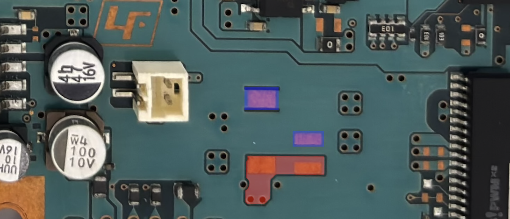

### GH-035-61
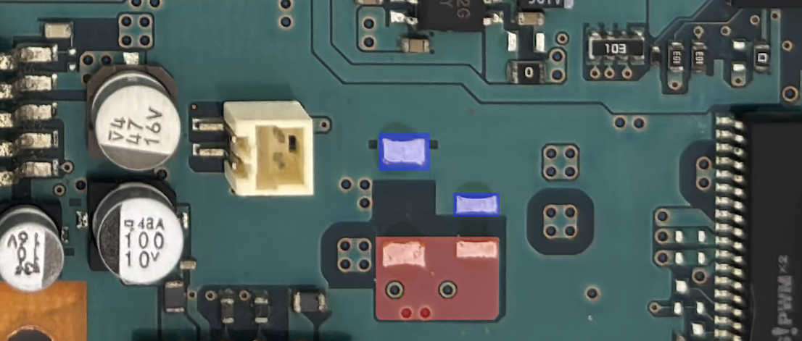

## Ground

Ground can be taken from the ground pads of the same unpopulated capacitor footprints used for 3.3V. The ground pads are highlighted in blue in the photos above.

Saint-Fall has reported that when testing the M2PS2 outside its fully installed state, write errors can occur if the ground wire is routed too far away from the IDE signal wires. He was able to reproduce this reliably, with file transfers to the SSD sometimes freezing after only a few kilobytes. He suspected this was caused by crosstalk between the individual IDE wires, and recommended keeping a ground wire close to the IDE signals to help shield them.

In the fully installed configuration, he found that the grounded metal shielding above the IDE wires, together with the ground plane of the PS2 motherboard beneath them, provided sufficient grounding for reliable operation.

If you encounter write errors or file transfer freezes when testing your M2PS2, particularly outside the fully installed console, try routing the ground wire closer to the IDE signals.

# Shell Cutting

## Coming soon
