# Ordering Guide

This guide covers ordering the M2PS2 PCB and flex cable using the provided Gerber files.

The original Gerber files are available from [Saint-Fall's original M2PS2 project thread](https://circuit-board.de/forum/index.php/Thread/33386-M2PS2-PCB-für-PS2-Slim-SCPH-700XX-zum-Betrieb-einer-M-2-SATA-SSD/?s=1bd99d781e0297b4f745be127a7221e8196c12e8). Download the relevant files before proceeding with the order.

## Ordering the Boards

### Layers
After uploading the Gerber ZIP file to the JLCPCB order form, it should automatically detect that the design is a 4-layer board and select the appropriate setting.

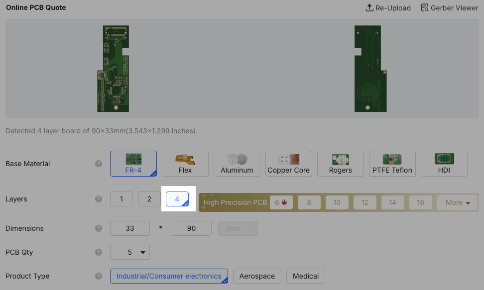

### PCB Specifications

First, change **PCB Thickness** to **0.8mm**.

You can change **PCB Color** and **Surface Finish** to your liking. I opted for **Black** and **ENIG** with my order, but it does increase the cost.

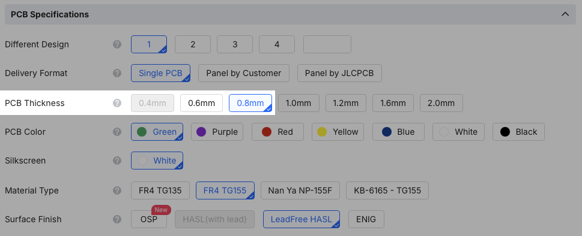

Next, set **Material Type** to **FR4 TG155**

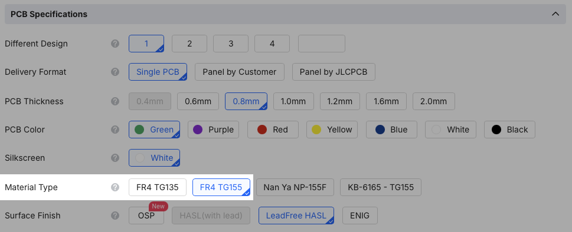

### High-spec Options

When I initially ordered the M2PS2 boards using Saint-Fall's original instructions, I encountered some confusion regarding impedance control. JLCPCB had since changed its order form, and the **Layer Stackup** and **Impedance Control** options no longer matched the original instructions.

Saint-Fall kindly helped me work through this. The following settings should be used with the current JLCPCB order form.

First, set **Specify Layer Sequence** to **Yes**, and configure the layer sequence as shown below.

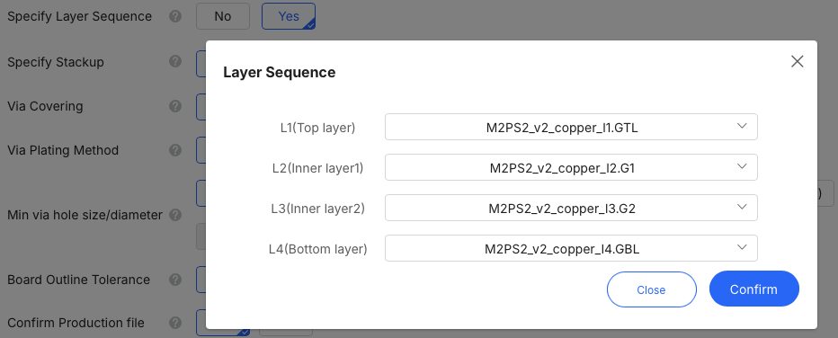

Next, set **Specify Stackup** to **Yes** and select **JLC04081H-3313** from the pop-up menu.

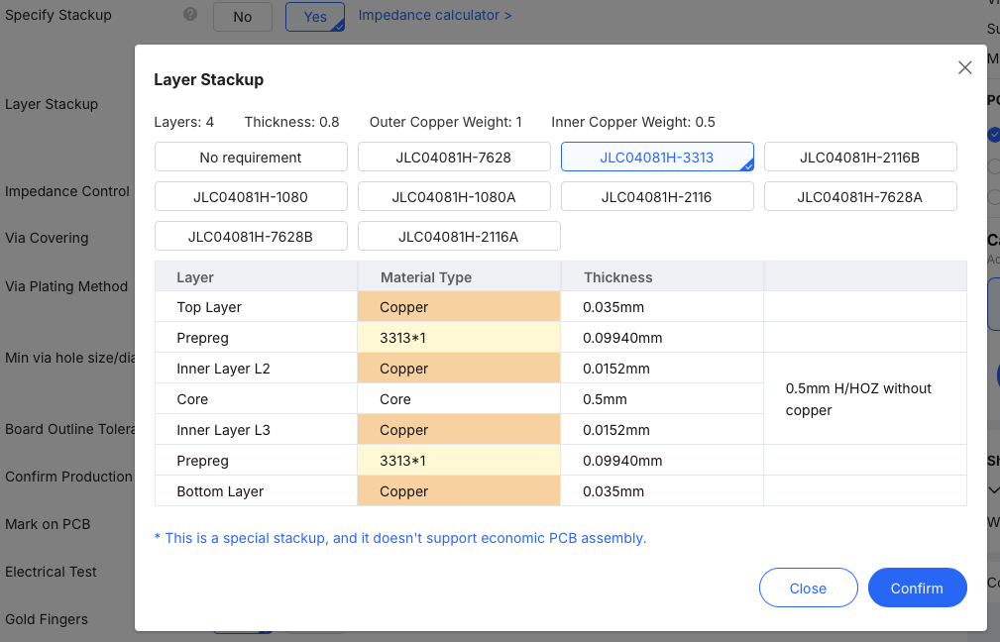

The **High-Spec Options** section should now look like the example below.

Note that **Impedance Control** should remain set to **No requirement**. Despite the stackup being specified above, you do not need to enable the separate impedance control option.

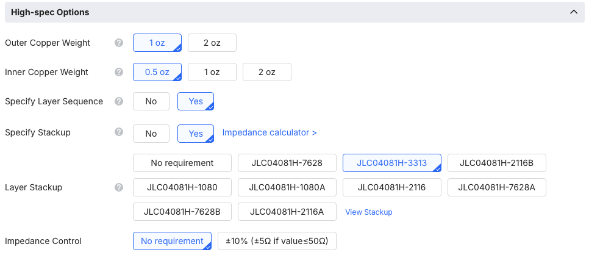

### Advanced Options

JLCPCB also offers a PCB Assembly service, which can be selected under **Advanced Options** when placing your order.

Saint-Fall has included a pick-and-place .slsx file alongside the Gerber files, which can be used when setting up the assembly order.

I haven't used JLCPCB's assembly service myself, so I can't offer any first-hand guidance on the process. If you intend to use it, check JLCPCB's assembly requirements and make sure all necessary files and components are available before proceeding.

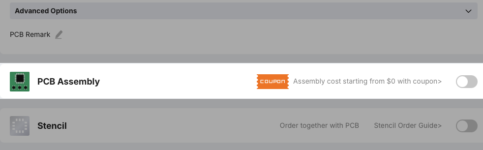

JLCPCB also offers the option to order a solder paste stencil alongside your PCB.

I opted not to include one in my order to keep the overall cost down, although in hindsight it's something I would have liked to try.

If you're experienced with stencil-based assembly, or are planning to assemble multiple boards, it's worth considering adding one to your order.

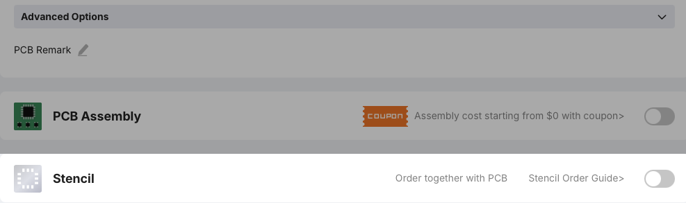

## Ordering the Flex

### Base Material

First, set **Base Material** to **Flex**

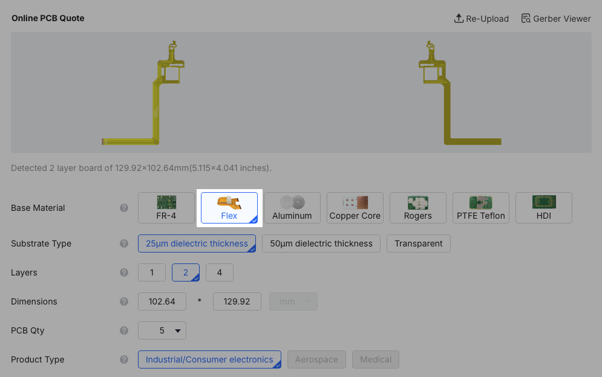

### PCB Specifications

Here, make sure **PCB Thickness** and **Copper Type** are set to **0.11mm** and **Electro-deposited** respectively.

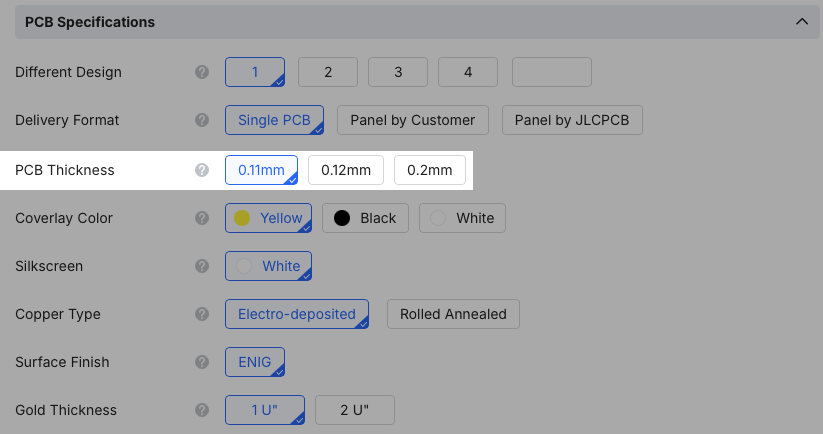

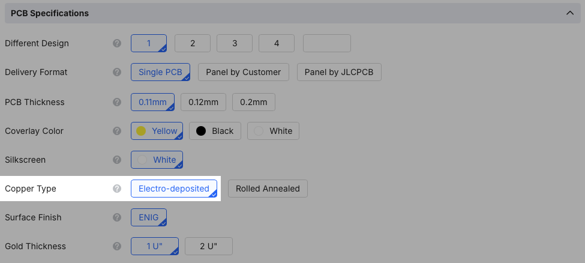

### High-spec Options

Next, set **Gold Fingers** to **Yes**, then set **Gold Fingers Thickness** to **0.18mm**

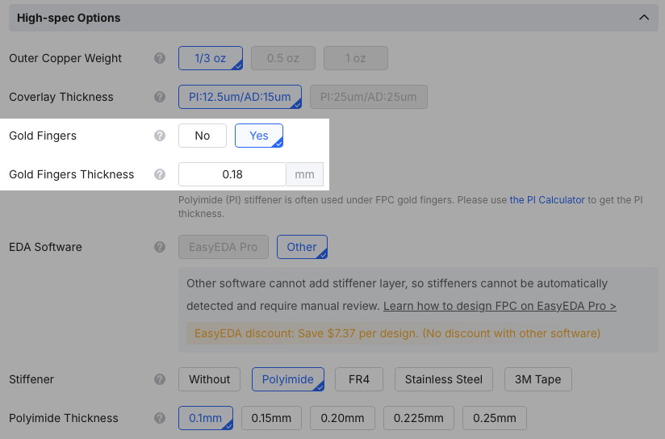

Next, set **Stiffener** to **Polyimide**, and set the **Polyimide Thickness** to **0.1mm**

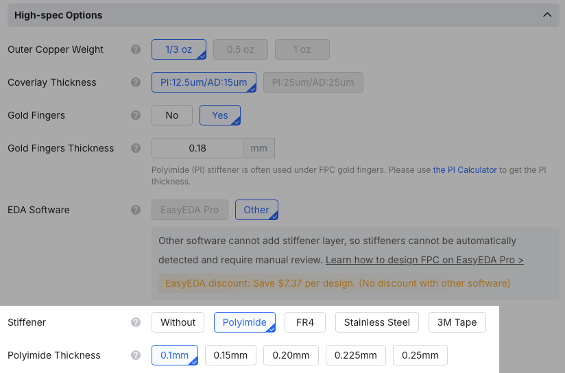

The flex requires two separate stiffener sections with different thicknesses. However, JLCPCB only allows one thickness to be selected in the order form. Saint-Fall has therefore included a PDF in the Gerber ZIP specifying the correct stiffener positions and individual thicknesses. The selected 0.1mm setting is not intended to override these specifications.

### Advanced Options

The included PDF also contains instructions for the fabricator. Make sure the following remarks are included when placing your order:

- Included PDF contains stiffener specs (stiffener must avoid pads and holes at board outline).
- Any pad protruding the board outline is by design and is to be treated as a castellated pad/hole.

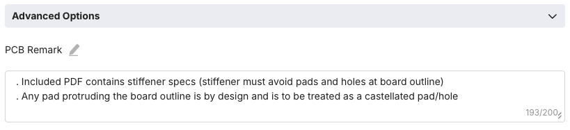
