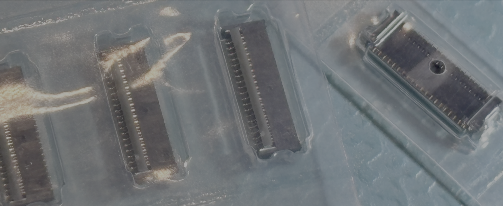
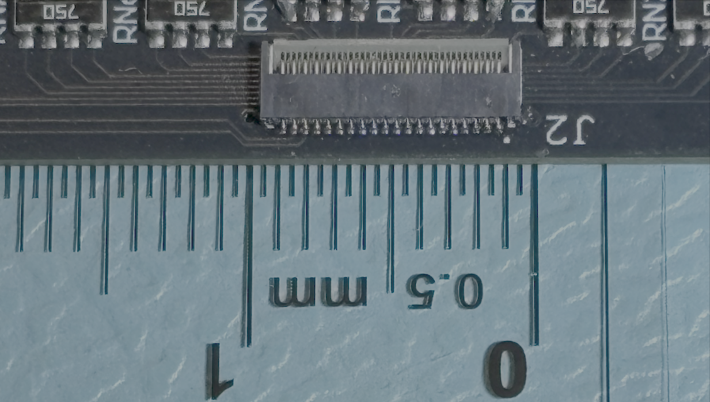
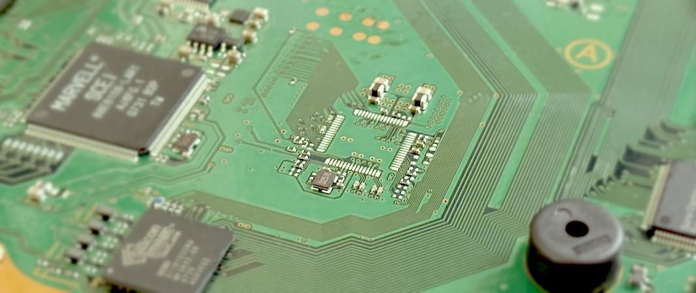
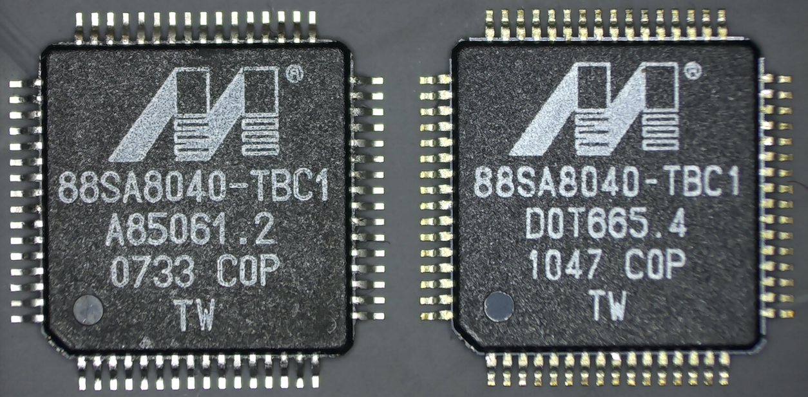

# Parts Sourcing

This section contains recommended replacement components and alternative parts for the M2PS2 project, particularly for components that are discontinued, difficult to source or no longer available from the original BOM.

## Contents
- [Ordering Components](#ordering-components)
- [Replacement Standoff](#replacement-standoff)
- [Molex Flex Connector](#molex-flex-connector)
- [Marvell IC Selection](#marvell-ic-selection)
- [Finding Alternative Components](#finding-alternative-components)

## Ordering Components

The original M2PS2 BOM, provided by Saint-Fall, uses Mouser product links. I've also put together an interactive BOM to make it easier to browse the components and find them across different suppliers.

Mouser and DigiKey are both good starting points when sourcing components for the project. It's worth comparing availability and pricing between the two, particularly when ordering larger quantities, as some components may be cheaper or more readily available from one supplier than the other.

You can use either BOM as a reference when searching for components on these websites:

- [Saint-Fall's Original BOM](https://circuit-board.de/forum/index.php/Thread/33386-M2PS2-PCB-für-PS2-Slim-SCPH-700XX-zum-Betrieb-einer-M-2-SATA-SSD/?s=1bd99d781e0297b4f745be127a7221e8196c12e8)
- [Interactive M2PS2 BOM](https://atherismods.github.io/M2PS2-Additional-Resources/Interactive_BOM/m2ps2_ibom.html)

## Replacement Standoff

The original BOM recommends purchasing a particular M.2 PCB and removing its standoff for use with the M2PS2. However, purchasing an additional PCB just to obtain the standoff seems a little wasteful, and the PCB is no longer available from the provided link.

Both alternative standoffs I've found protrude slightly through the 0.8mm-thick M2PS2 PCB. The protruding section should be filed or sanded down until flush with the underside of the board.

Here are two alternative options that fit the M2PS2, with links to purchase them from AliExpress.

### M2 Standoff (Recommended)

This is the option I'd recommend. The section that slots into the PCB is 1mm tall, so it only just protrudes through the board.

You can file this down until flush. Alternatively, if you're using double-sided tape to secure the M2PS2 PCB, you might not need to shorten it at all, depending on the thickness of the tape.

- [Standoff - M2 x 1.5 x 4](https://www.aliexpress.com/item/1005011956873703.html?spm=a2g0o.order_list.order_list_main.40.523c18026HUpmF)

- [Screw - M2 x 3mm](https://www.aliexpress.com/item/4000310413115.html?spm=a2g0o.order_list.order_list_main.30.523c18026HUpmF)

  
  
  

### M2.5 Standoff

This is a slightly larger alternative. It protrudes approximately 0.4mm through the underside of the M2PS2 PCB and therefore requires a little more filing to sit flush.

It is a perfectly usable alternative if you prefer the larger M2.5 standoff and screw, although I find the M2 option easier to work with.

- [Standoff - M2.5 x 4.5 x 1.5-3 x 1.2](https://www.aliexpress.com/item/1005005593361750.html?spm=a2g0o.order_list.order_list_main.55.523c18026HUpmF)

- [Screw - M2.5 3mm](https://www.aliexpress.com/item/1005004510637964.html?spm=a2g0o.order_list.order_list_main.64.523c18026HUpmF)

  
  
  

## Molex Flex Connector

The Molex connector is one of the more delicate components on the M2PS2 PCB. Its fine-pitch pins are particularly fragile, and soldering it can be challenging even with suitable equipment and experience.

Given the difficulty of assembling this connector, I'd recommend purchasing a few spares when ordering components. It's easy to damage the pins during handling or soldering, and having replacements available could save you from having to place another order.

I sourced mine from AliExpress, as DigiKey only offered them in reels of 13,000 at the time. Although DigiKey now offers individual connectors, they are considerably more expensive than the alternatives I found on AliExpress.

Given the difference in price, I was initially sceptical about the quality of the AliExpress alternatives. If you decide to source them this way, be aware that the connectors may be of lower quality than those supplied by DigiKey. However, the ones I received worked fine in my builds.

The image below shows a soldered example to give an idea of just how small the connector and its pins are.

## Marvell IC Selection

There are two different Marvell ICs compatible with the M2PS2:

- 88SA8040-TBC1
- 88SA8052-TBC2

Both work equally well in this application.

The Marvell IC selected for U1 determines which voltage regulator (U2) and resistor (R2) are required.

Make sure you select the correct components for your chosen IC when ordering.

### Component Configurations

| **U1** | 88SA8040-TBC1 | 88SA8052-TBC2 |
|:---|:---|:---|
| **U2** | AP2114H-1.8TRG1 | AP2114H-1.2TRG1 |
| **U2 Voltage** | 1.8V | 1.2V |
| **R2** | RT0603DRE0712K1L | RT0603BRD076K04L |
| **R2 Value** | 12.1kΩ | 6.04kΩ |

### Marvell 88SA8040-TBC1

The 88SA8040-TBC1 can be harvested from donor PlayStation 3 motherboards.

According to the [PS3 Developer Wiki](https://www.psdevwiki.com/ps3/88SA8040-TBC1), early PS3 consoles up to and including model CECH-K, with motherboard revision DIA-002, use this IC.

You can also purchase both the 88SA8040-TBC1 and 88SA8052-TBC2 from AliExpress.

I opted to buy several 88SA8040-TBC1 chips from different sellers for testing. After checking diode readings and testing them with the M2PS2 boards, all the samples I bought worked perfectly fine.

### Original vs AliExpress ICs

The image below shows a comparison between an IC harvested from a PS3 (left) and one purchased from AliExpress (right).

One thing worth noting when shopping for these ICs on AliExpress is that some listings show chips without the Marvell logo. This was the case with both batches I ordered, but all the chips I received actually had the Marvell logo printed on them.

## Finding Alternative Components

When sourcing components for my builds, I compared the availability and overall cost of ordering the BOM from both Mouser and DigiKey. Some components were either out of stock or only available in quantities that weren't practical for a small batch of boards.

Both Mouser and DigiKey have tools to help identify alternative components when an item is out of stock. These are a good starting point when looking for replacements.

For my builds, I also used AI to help identify potential alternatives, comparing their specs against the original components to check their suitability before ordering.

If you encounter a component that is out of stock, only available with a high minimum order quantity, or otherwise difficult to source, I'd recommend first checking the alternative parts suggested by Mouser or DigiKey. If you're still having trouble identifying a compatible replacement, feel free to open an issue on GitHub and I'll do my best to help.
