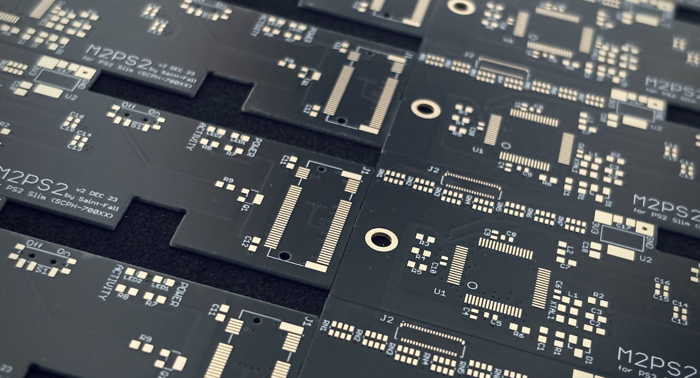

# M2PS2 Additional Resources

This repository is an independent, unofficial collection of supplementary resources for builders of the Saint-Fall M2PS2 project. It is not affiliated with, endorsed by, or maintained by Saint-Fall.

Full credit and thanks go to Saint-Fall for designing and sharing the original M2PS2 project. This repository exists purely as a community contribution, made out of appreciation for a fantastic project.

### Link to [Original M2PS2 Project](https://circuit-board.de/forum/index.php/Thread/33386-M2PS2-PCB-für-PS2-Slim-SCPH-700XX-zum-Betrieb-einer-M-2-SATA-SSD/?s=1bd99d781e0297b4f745be127a7221e8196c12e8) by Saint-Fall

# Contents

- [Interactive M2PS2 BOM](https://atherismods.github.io/M2PS2-Additional-Resources/Interactive_BOM/m2ps2_ibom.html)
- [Ordering Guide](Ordering_Guide/README.md)
- [Parts Sourcing](Parts_Sourcing/README.md)
- [Assembly Tips](Assembly_Tips/README.md)
- [Install Tips](Install_Tips/README.md)
- [Diagrams](Diagrams/README.md)

# About this repository

Having really enjoyed building my M2PS2 boards, I wanted to share some additional resources to make the process easier for others.

In early 2026, a group of friends and I chipped in together to meet the project's minimum order quantity. During our builds, I put together additional diagrams, component alternatives and build notes to help us along the way.

This repository brings all of those resources together in one place, with the hope of helping other builders with ordering, assembly and testing.

# What's included

- Interactive BOM: A KiCad-generated interactive HTML bill of materials for identifying components on the PCB.

- Ordering Guide: Additional guidance for navigating the PCB ordering process, including notes on manufacturing options and requirements when ordering through JLCPCB.

- Parts Sourcing: Recommended replacement components and alternatives for parts that are difficult to find or no longer available.

- Assembly Tips: Personal notes and guidance based on my own experience assembling the boards.

- Install Tips: Notes on the installation process of the flex and PCB.

- Diagrams: Additional diagrams and references for continuity testing and troubleshooting.

# Important Notes

- These resources supplement, rather than replace, the original project documentation.
- Always refer to [Saint-Fall's original documentation](https://circuit-board.de/forum/index.php/Thread/33386-M2PS2-PCB-für-PS2-Slim-SCPH-700XX-zum-Betrieb-einer-M-2-SATA-SSD/?s=1bd99d781e0297b4f745be127a7221e8196c12e8) for authoritative design information.
- Verify component specifications and compatibility before purchasing or installing alternatives.

# Credits & Thanks

All credit for the original M2PS2 design goes to Saint-Fall.

Thank you for creating such a brilliant project and sharing it with the community.

Happy building!
